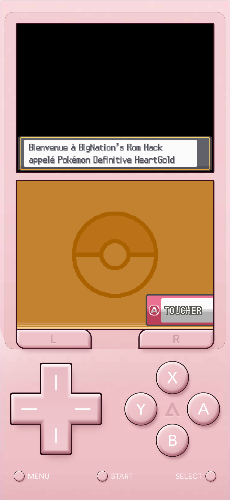

# Pokémon Definitive HeartGold — édition française

Un portage français non officiel du patch **Pokémon Definitive HeartGold**, préparé pour la ROM française de **Pokémon Version Or HeartGold**.

## Contenu

- Les modifications de jeu et les ajouts du patch Definitive HeartGold d’origine (version US).
- Les ressources françaises du jeu de base réintégrées dans la version modifiée : textes d’origine, données localisées et éléments graphiques français compatibles.
- Les textes ajoutés ou modifiés par le hack traduits de l’anglais vers le français.
- Un patch **xdelta** qui ne contient que les différences avec la ROM française propre. Aucune ROM Nintendo n’est distribuée ici.

Les textes propres au hack ont été traduits automatiquement hors ligne. Ils n’ont pas été relus intégralement par un traducteur humain ; des formulations, noms ou retours à la ligne peuvent être imparfaits. Le jeu n’a pas encore été validé en entier sur émulateur ou console.

## Fichier à télécharger

Rendez-vous dans [Releases](../../releases/latest) et téléchargez **Pokemon-Definitive-HeartGold-FR.xdelta**.

## ROM nécessaire

Le patch s’applique à une copie propre de :

**Pokémon - Version Or HeartGold (France).nds**  
**CRC32 attendu : `533A6E55`**

Le patch ne fonctionnera pas sur la ROM US, une ROM déjà modifiée, ni une autre révision.

## Appliquer le patch

Avec **Delta Patcher** ou un autre outil compatible xdelta :

1. Faites une copie de sauvegarde de votre ROM française propre.
2. Ouvrez l’outil de patch et sélectionnez cette ROM comme **fichier source**.
3. Sélectionnez **Pokemon-Definitive-HeartGold-FR.xdelta** comme fichier de patch.
4. Choisissez un nouveau nom de fichier de sortie, par exemple `Pokemon Definitive HeartGold FR.nds`.
5. Lancez l’application du patch et ouvrez le fichier obtenu dans votre émulateur ou sur votre matériel compatible.

Si le programme indique que la ROM source ne correspond pas, vérifiez son CRC32 et assurez-vous de partir d’une copie non modifiée.

## Projet non officiel

Ce projet de fans n’est ni affilié à Nintendo, Game Freak ou aux auteurs du hack Definitive HeartGold, ni approuvé par eux. Pokémon et les marques associées appartiennent à leurs ayants droit. Les utilisateurs doivent fournir leur propre copie légale du jeu.
